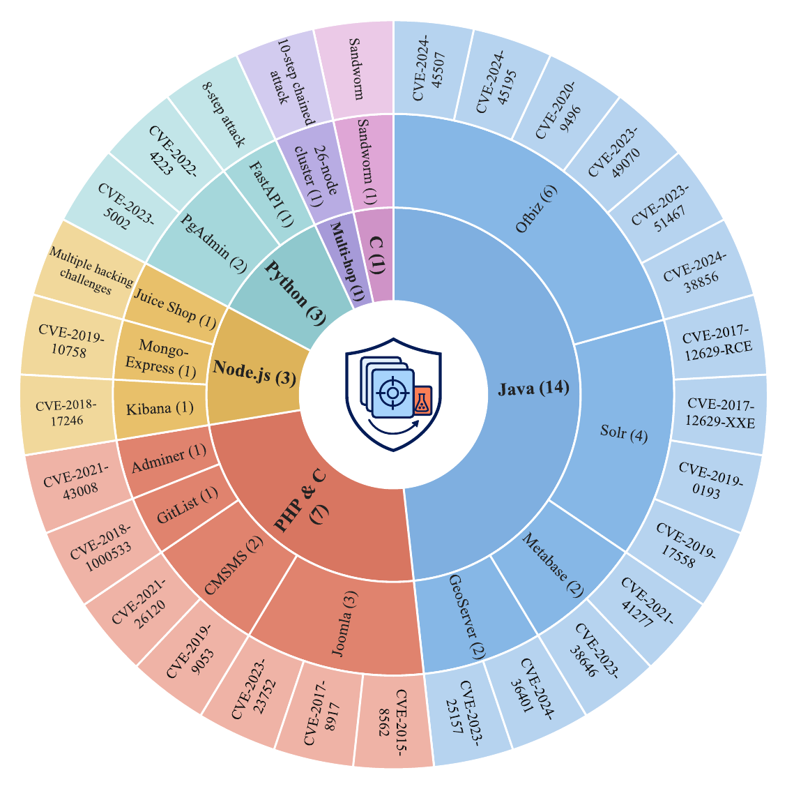

# Dataset construction

Purpose: construct raw multi-source security-log runs from Docker scenarios.

<p align="center">
  
</p>
<p align="center"><sub><i>The construction batch in <code>build.sh</code> covers 29 reproducible attack scenarios, grouped by application stack.</i></sub></p>

Scenario descriptions are in [scenario_descriptions.md](scenario_descriptions.md).

Primary entry points:

```bash
bash build.sh
BATCH=1 poetry run python main.py --config-path example/python-demo \
  --output-path results/python-demo
```

Runtime prerequisites:

- Linux with Bash, Docker Engine, and Docker Compose support;
- Python 3.11 and Poetry;
- Sysdig, tcpdump, conntrack, nsenter, and sudo/root capture privileges.

## Reproduce the build environment

Run these commands from this directory (the directory that contains
`build.sh`). They use only paths relative to the release tree.

Install the host packages and enable Docker:

```bash
sudo apt update
sudo apt install -y docker.io docker-compose gzip curl nano
sudo systemctl enable --now docker
```

Install Sysdig and the network-capture tools:

```bash
curl -s https://download.sysdig.com/stable/install-sysdig | sudo bash
sudo apt install -y tshark conntrack tcpdump
```

Install Python 3.11 if it is not already available, then install Poetry and
select that interpreter for the locked environment:

```bash
python3.11 --version
pip install --user poetry
poetry env use python3.11
poetry install
poetry run python main.py --help
```

You can perform a side-effect-free environment smoke test with:

```bash
poetry run python -c "print('ok')"
```

Download the `all_images.tar.gz` archive from the
[AutoLabel](https://zenodo.org/records/15540310) record and place it beside `build.sh`
before importing it. The direct download link is
[`all_images.tar.gz`](https://zenodo.org/records/15540310/files/all_images.tar.gz?download=1).
The archive is approximately 30.8 GB and its published MD5 checksum is
`45ca849acff7a95a4650bdbba0686527`.

```bash
# Optional: verify the download before importing it.
md5sum all_images.tar.gz
gzip -d all_images.tar.gz       # produces all_images.tar
sudo docker load -i ./all_images.tar
```

If Docker reports `no space left on device`, free Docker storage or use a
larger data partition. Some hosts also need the following kernel and file
descriptor limits for large capture runs:

```bash
# Apply until reboot
sudo sysctl -w vm.max_map_count=262144

# Persist across reboots
echo "vm.max_map_count=262144" | sudo tee -a /etc/sysctl.conf
sudo sysctl -p
```

Append these lines to `/etc/security/limits.conf`, then log out and back in (or
reboot) before a full run:

```text
* soft nofile 1048576
* hard nofile 1048576
```

## Run and validate

Validate every bundled scene without starting Docker:

```bash
poetry run python validate_construction_inputs.py
```

Run one scene, or run the official batch:

```bash
BATCH=1 poetry run python main.py --config-path example/python-demo \
  --output-path results/python-demo
bash build.sh
```

`build.sh` writes `results/<scenario>/<timestamp>/raw` and `index` below this
stage directory. Keep the current directory at the stage root when invoking
it so that `example/`, `results/`, and the capture helpers resolve correctly.
The single-scene command above uses the same layout. Without `--output-path`,
`main.py` writes to `results/<timestamp>/` directly.

`main.py` connects to Docker only when a scene actually starts, so help and
configuration validation remain side-effect free. `build.sh` contains the
construction batch, while `example/` retains the complete set of scenario
definitions and auxiliary multi-jump inputs.

Key runtime content:

- `example/`: required scenario definitions, Dockerfiles, services, and action drivers;
- `hook/`, `modify/`, `sysdig_rules/`: capture and instrumentation support;
- `print_fields_new.lua`: required by `load_logs.py` when converting Sysdig captures;
- `analyze.py`: produces derived `raw/index` run products after capture;
- `pyproject.toml` and `poetry.lock`: Python environment definition.

The attacker-IP mapping used by the glibc hook is
`modify/hook_glibc_attacker/ip_list.h`. `modify/hook_glibc_attacker/configure.py`
generates this header from `config_attack.py`, which the builder populates
with the scenario's IP remapping. The C hook replaces matching IPv4 destination
addresses in `connect`/`sendto` calls. The header is generated as part of the
hook build when the scenario requires it.

`example/` is the complete runtime input tree. Keep its Dockerfiles, Compose
files, action drivers, hidden build-context files, and scenario fixtures
together when running the builder. The `hook/` tree keeps the rebuildable
source, build scripts, and runtime artifacts used by the scenario Dockerfiles.
Construction and validation entry points are kept in this stage root.

Some bundled scenarios contain Python 2 proof-of-concept code. Run
those programs only inside their declared Docker environment.

This stage creates the input consumed by stage 02. Install the host runtime
and privileged capture tools before running a capture.

## Acknowledgements

The construction framework in this directory is adapted from
[AutoLabel](https://github.com/autolabel-open/autolabel) (Peng et al.,
USENIX Security 2025). AutoLabel's code, documentation, and Docker images are
archived at [doi:10.5281/zenodo.15540310](https://doi.org/10.5281/zenodo.15540310),
Copyright (C) 2025 by Yihao Peng, Tongxin Zhang, Jieshao Lai, Yuxuan Zhang,
Yiming Wu, Hai Wan, and Xibin Zhao, and licensed under
[CC BY 4.0](https://creativecommons.org/licenses/by/4.0/). SecLog modifies and
extends this code, including the scenario configurations and additional
indexing, export, and validation scripts. We thank the AutoLabel authors for
releasing their framework and Docker images.
