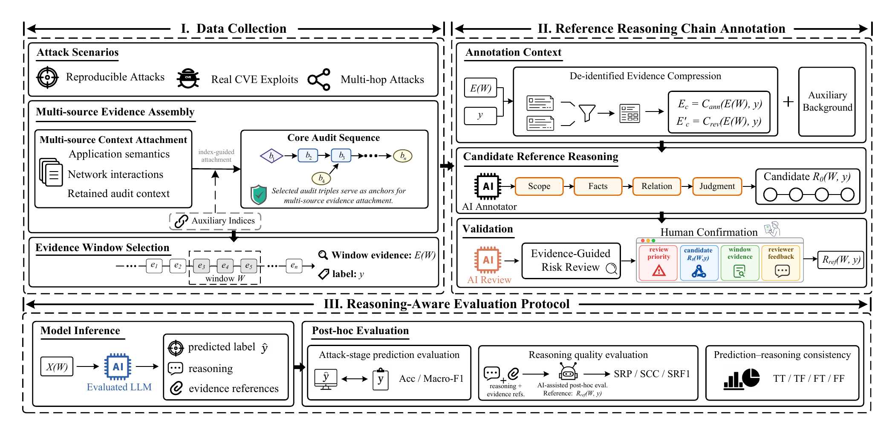
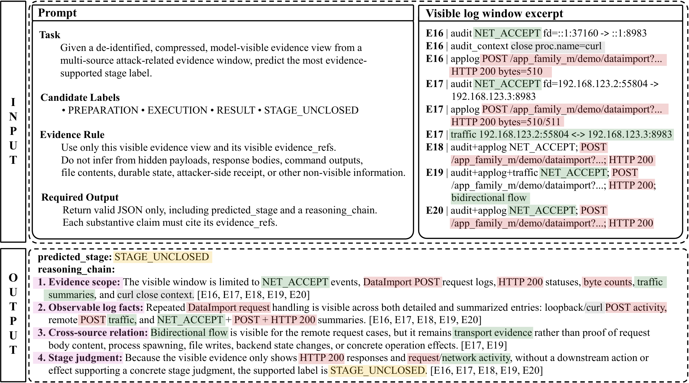

# SecLog

SecLog supports research on attack-stage reasoning from multi-source security
logs. It provides tools to collect logs from reproducible Docker attack and
normal-activity scenarios, organize the evidence into attack chains, construct
labeled datasets, and evaluate model predictions.

The release includes **SecLog-Bench-216**, a ready-to-use benchmark of 216
evidence windows with reviewed stage labels and reference reasoning chains.
Researchers can use the supplied benchmark directly or run the construction
pipeline to produce new data.

Construction resources on Zenodo: [Docker images](https://doi.org/10.5281/zenodo.23474857),
[raw logs and alignment indices](https://doi.org/10.5281/zenodo.23536103), and
[constructed attack chains](https://doi.org/10.5281/zenodo.23525715).

<p align="center">
  
</p>
<p align="center"><sub><i>Figure 1. SecLog overview. Part I corresponds to stages 01–04, Part II to the annotation and review workflow in 05, and Part III to the evaluation workflow in 05 with SecLog-Bench-216.</i></sub></p>

## Main features

- **Multi-source log collection:** capture system-call audit logs, network
  traffic, and application logs from bundled simulation scenarios.
- **Attack-chain construction:** organize collected evidence into an audit
  backbone with application and traffic context.
- **Dataset export and window selection:** export chain products as datasets
  or select evidence windows for annotation.
- **Annotation and review:** prepare prompts with source-identifying
  information masked, run API-based annotation and review, and inspect
  candidates through the human-review UI.
- **Benchmark evaluation:** normalize model responses, score attack-stage
  predictions, and assess reasoning using the documented evaluation protocol.

## Choose a starting point

| Your goal | Start here | Environment |
| --- | --- | --- |
| Read or reuse the supplied dataset | [SecLog-Bench-216](SecLog-Bench-216/README.md) and [data examples](#input-and-output-examples) | Any JSONL reader; Python 3.11 for the validator |
| Evaluate a model on the supplied benchmark | [Quick start](#quick-start-evaluate-the-supplied-benchmark) | Python 3.11; an API endpoint and key for the bundled inference runner |
| Collect new logs and construct a dataset or benchmark | [Data construction](#collect-new-logs-and-build-datasets) | Ubuntu Linux, Python 3.11, Poetry, Docker, and capture tools |

Detailed system packages, optional components, and dependency versions are
listed in [ENVIRONMENT_DEPENDENCIES.md](ENVIRONMENT_DEPENDENCIES.md).

## Quick start: evaluate the supplied benchmark

These commands use Bash and run from the **project root**. Start with an
isolated Python 3.11 environment:

```bash
python3.11 -m venv ../seclog-env
source ../seclog-env/bin/activate
```

The commands below use the Python standard library. For log collection,
annotation, the review UI, and additional analysis, see the
[environment guide](ENVIRONMENT_DEPENDENCIES.md).

### 1. Validate the dataset

```bash
python 05_benchmark_annotation_review_evaluation/scripts/validate_public_benchmark.py
```

The validator checks the sample counts, IDs, label distribution, evidence
references, and manifest hashes. Successful validation reports
`validation_passed: true` and `sample_count: 216` in its JSON output.

### 2. Check an inference configuration

Replace `your-model-name` with the model identifier supported by your
provider:

```bash
python 05_benchmark_annotation_review_evaluation/evaluation/run_benchmark_inference.py \
  --prompt-pack SecLog-Bench-216/data/prompt_pack.jsonl \
  --model your-model-name \
  --output ../seclog-runs/example/raw_responses.jsonl
```

This command reports `mode: preflight_no_api` and the prompt count. It
does not contact the provider or create a response file, and it does not
verify that the provider supports the selected model.

### 3. Run model inference

Set `OPENAI_API_KEY` in your shell environment, replacing the placeholder
below with your provider key, then explicitly enable API calls:

```bash
export OPENAI_API_KEY="YOUR_API_KEY"
python 05_benchmark_annotation_review_evaluation/evaluation/run_benchmark_inference.py \
  --prompt-pack SecLog-Bench-216/data/prompt_pack.jsonl \
  --model your-model-name \
  --output ../seclog-runs/example/raw_responses.jsonl \
  --call-api
```

The runner uses an OpenAI-compatible chat endpoint. Its default base URL is
`https://api.openai.com/v1`; pass `--base-url` for another endpoint and
`--api-key-env` for another key-variable name. Keep the output directory
outside the release tree, as in this example. Use a new output path for each
run, or add `--resume` to continue an existing response file.

To use your own inference system, including models that reject `temperature`,
`max_tokens`, or JSON mode, use `SecLog-Bench-216/data/prompt_pack.jsonl` and the
[prediction format](SecLog-Bench-216/schemas/output_schema.json), then pass
the raw outputs to the normalizer below.

### 4. Normalize and score the responses

```bash
python 05_benchmark_annotation_review_evaluation/evaluation/normalize_stage_reasoning_predictions.py \
  --input ../seclog-runs/example/raw_responses.jsonl \
  --output ../seclog-runs/example/predictions.jsonl

python 05_benchmark_annotation_review_evaluation/evaluation/evaluate_stage_reasoning_predictions.py \
  --gold SecLog-Bench-216/data/gold_labels.jsonl \
  --reference-chains SecLog-Bench-216/data/reference_reasoning_chains.jsonl \
  --model-input SecLog-Bench-216/data/evidence_windows.jsonl \
  --sample-index SecLog-Bench-216/data/sample_index.jsonl \
  --predictions ../seclog-runs/example/predictions.jsonl \
  --output-dir ../seclog-runs/example/evaluation
```

Results include:

| Output | Contents |
| --- | --- |
| `predictions.jsonl` | Normalized model predictions |
| `invalid_outputs.jsonl` | Responses that could not be normalized successfully |
| `evaluation/metrics_summary.json` | Aggregate evaluation metrics |
| `evaluation/per_sample_results.jsonl` | Per-sample results |
| `evaluation/confusion_matrix.csv` | Stage-prediction confusion matrix |
| `evaluation/per_stage_metrics.csv` | Metrics by stage |
| `evaluation/error_cases.jsonl` | Cases retained for error analysis |

Reference/evidence overlap in this evaluator is diagnostic. Formal
reasoning-quality scoring requires the additional checklist and assistant
review workflow in
[Post-hoc reasoning quality](05_benchmark_annotation_review_evaluation/README.md#post-hoc-reasoning-quality).

## Input and output examples

<details open>
<summary>Show an illustrative prompt and model output</summary>
<br>
<p align="center">
  
</p>
<p align="center"><sub><i>Figure 2. Illustrative example. In the released files, stage labels are lowercase (for example, <code>stage_unclosed</code>) and evidence references use sample-local <code>edge_id</code> values.</i></sub></p>
</details>

The benchmark uses JSONL: each line is one JSON object, joined across files by
`sample_id`.

| File under `SecLog-Bench-216/data/` | Role |
| --- | --- |
| `evidence_windows.jsonl` | Model-visible evidence, including the selected chain and attached context |
| `prompt_pack.jsonl` | Prepared messages for model inference |
| `gold_labels.jsonl` | Reviewed labels used for evaluation |
| `reference_reasoning_chains.jsonl` | Reviewed reference claims and evidence references |
| `sample_index.jsonl` | Sample ordering and window metadata |
| `dataset_manifest.json` | Dataset metadata |

For example, this is an **abbreviated excerpt** from the evidence for
`sample_000001`. Other edges, context, and metadata are omitted here;
use the full record or prepared prompt for inference.

```json
{
  "sample_id": "sample_000001",
  "window": {
    "start_seq": 10,
    "end_seq": 14
  },
  "selected_spine": [
    {
      "seq": 10,
      "edge_id": "sample_000001_edge_000001",
      "subject": "proc_m",
      "relation": "PROCESS_FORK",
      "object": "proc_m"
    }
  ]
}
```

The corresponding **actual gold-label record** is:

```json
{
  "sample_id": "sample_000001",
  "gold_stage": "preparation",
  "supportability_tier": "strong",
  "window": {
    "start_seq": 10,
    "end_seq": 14
  }
}
```

A model returns `predicted_stage` and an evidence-referenced
`reasoning_chain`, following the
[output format](SecLog-Bench-216/schemas/output_schema.json). The gold label
above is a reference answer, not a measured model prediction. Keep labels and
reference reasoning out of tested-model prompts.

Each of the four labels has **54 samples**:

| Label | Meaning |
| --- | --- |
| `preparation` | Visible evidence supports probing, checking, or positioning before a concrete attack operation |
| `execution` | Visible evidence supports a concrete attack-relevant operation |
| `result` | Visible evidence supports a downstream effect of attack activity |
| `stage_unclosed` | Evidence is attack-related but does not safely establish one of the three stages |

`stage_unclosed` is not a benign label. Full definitions are in the
[label schema](SecLog-Bench-216/schemas/label_schema.json).

## Collect new logs and build datasets

The construction workflow targets **Ubuntu Linux with Python 3.11**. Prepare
Docker Engine/Compose, Sysdig, Tshark/tcpdump, conntrack, nsenter, and the
required sudo/root capture privileges using the
[construction environment instructions](01_dataset_construction/README.md#reproduce-the-build-environment).

After preparing those prerequisites and the scenario images, install the
stage-01 Python dependencies and validate the bundled scene inputs:

```bash
cd 01_dataset_construction
python3.11 -m pip install poetry
poetry env use python3.11
poetry install
poetry run python validate_construction_inputs.py
```

From the same directory, collect one scenario:

```bash
BATCH=1 poetry run python main.py \
  --config-path example/python-demo \
  --output-path results/python-demo
```

This starts the declared simulation and produces
`results/python-demo/<timestamp>/raw/` and `index/`. Use
`bash build.sh` for the documented batch construction workflow.

Poetry installs the host construction dependencies; scenario services use
their Docker environments. Keep the bundled scenario inputs and runtime
artifacts together, as described in the
[construction README](01_dataset_construction/README.md), then follow the
stage-specific guides below.

## Pipeline and project layout

```text
01  Docker scenarios and multi-source capture
    -> raw/ + index/
       |
02     Attack-chain construction
       -> chain/
          |
          +-> 03  Dataset release export
          |       -> exported dataset
          |
          +-> 04  Benchmark window selection
                  -> annotation_ready_seed.jsonl
                     |
05                   Prompt preparation, annotation, and human review
                     -> reviewed benchmark candidates

SecLog-Bench-216 (bundled, frozen benchmark)
    -> model inference -> prediction normalization -> evaluation
```

Stages 03 and 04 both read the stage-02 chain products. Rebuilding the
construction pipeline is optional when evaluating the bundled benchmark;
newly constructed and reviewed candidates are separate from the frozen
`SecLog-Bench-216` release.

| Directory | Purpose and guide |
| --- | --- |
| `01_dataset_construction/` | [Collect logs from Docker scenarios](01_dataset_construction/README.md) |
| `02_attack_chain_construction/` | [Build attack chains from raw/index products](02_attack_chain_construction/README.md) |
| `03_dataset_release_generation/` | [Export existing chain products as datasets](03_dataset_release_generation/README.md) |
| `04_benchmark_window_selection/` | [Select evidence windows and produce the annotation handoff](04_benchmark_window_selection/README.md) |
| `05_benchmark_annotation_review_evaluation/` | [Prepare prompts, annotate, review, and evaluate](05_benchmark_annotation_review_evaluation/README.md) |
| `SecLog-Bench-216/` | [Use the supplied benchmark and its schemas](SecLog-Bench-216/README.md) |

Subdirectory guides specify working directories and input/output contracts;
substitute paths to your own constructed runs when following those workflows.

## License

Original SecLog code and documentation are licensed under the [MIT License](LICENSE).
The [SecLog-Bench-216 dataset](SecLog-Bench-216/README.md) is licensed under
[CC BY 4.0](SecLog-Bench-216/LICENSE).

Upstream and third-party materials retain their own licenses; the MIT license
applies only to SecLog's original contributions. See the
[construction acknowledgements](01_dataset_construction/README.md#acknowledgements)
for AutoLabel attribution and licensing information.
